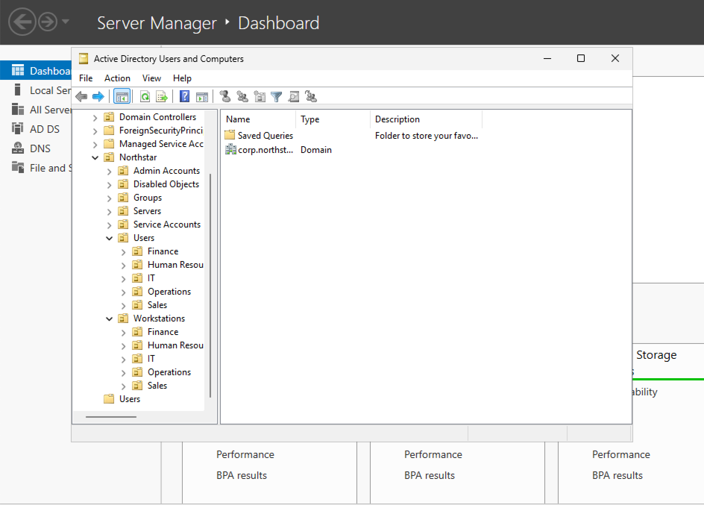
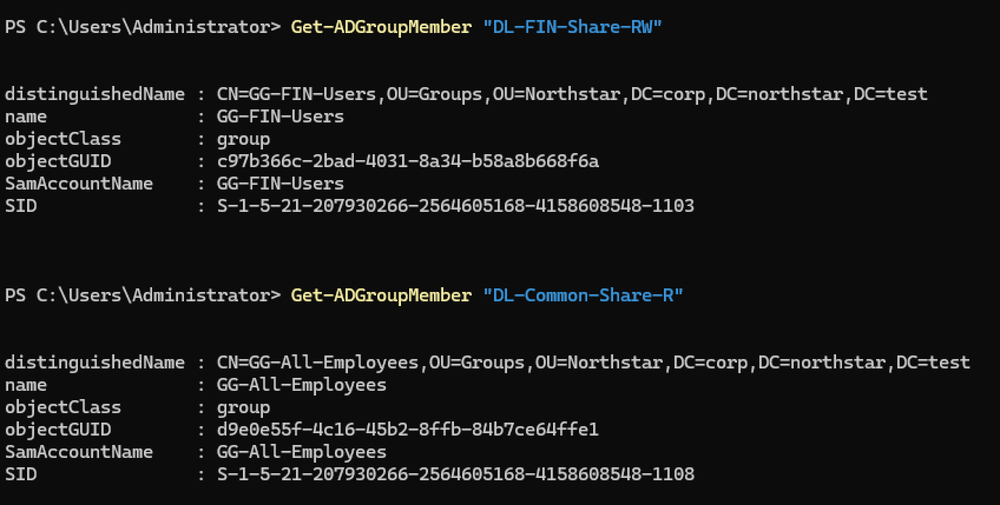
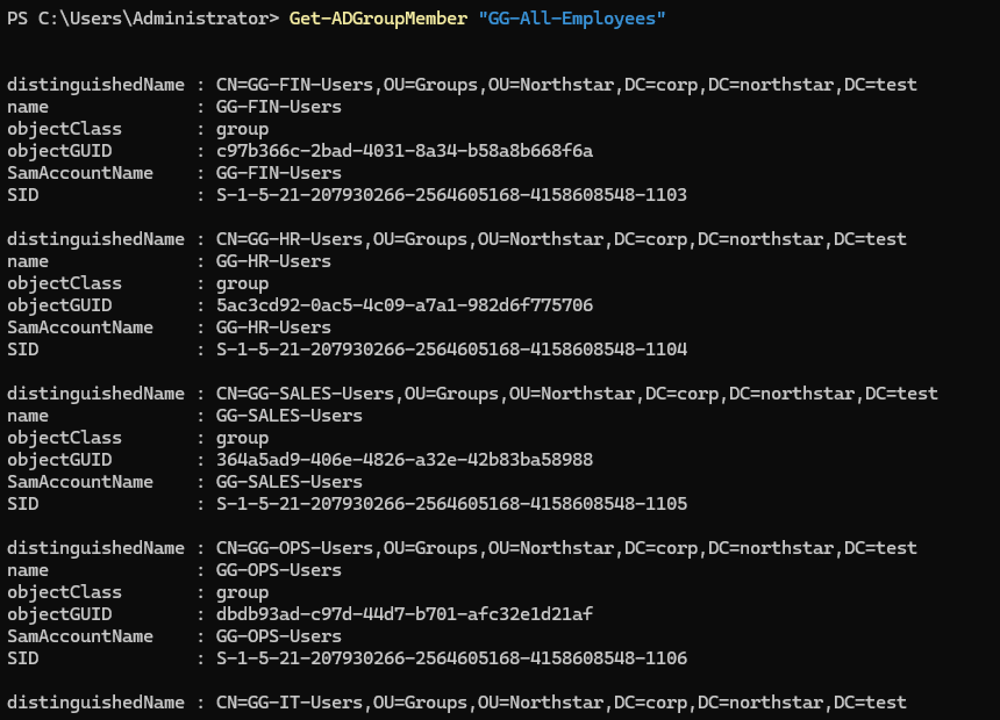
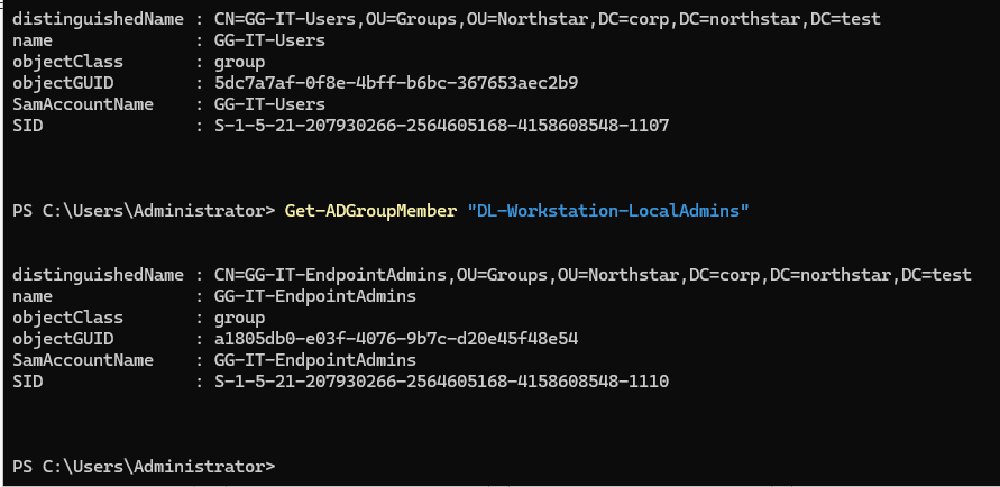

# Northstar Enterprise Endpoint Lab

> Simulated 200-user Windows Server 2025 enterprise environment focused on Active Directory, endpoint administration, PowerShell automation, RBAC, DNS, DHCP, Group Policy, and Windows 11 management.

## Project Overview

Northstar Business Solutions is a fictional 200-employee organization used to simulate the design, deployment, administration, and troubleshooting of a Windows enterprise environment.

The project is being built as a hands-on endpoint and systems administration case study rather than a basic home lab. The environment emphasizes repeatable automation, role-based access control, Active Directory design, endpoint management, documentation, and troubleshooting.

## Current Architecture

| Component | Configuration |
|---|---|
| Domain | `corp.northstar.test` |
| NetBIOS Domain | `NORTHSTAR` |
| Domain Controller | `DC01` |
| DC01 IPv4 | `10.10.10.10/24` |
| Gateway | `10.10.10.1` |
| Server OS | Windows Server 2025 Standard Evaluation |
| Forest Functional Level | Windows Server 2025 |
| Domain Functional Level | Windows Server 2025 |
| Hypervisor | Oracle VirtualBox |
| Client OS | Windows 11 Pro |
| Simulated Company Size | 200 employees |

## Lab Evidence

### Active Directory OU Structure

The Northstar domain uses a structured OU hierarchy that separates users, workstations, servers, privileged accounts, service accounts, groups, and disabled objects.



### RBAC / AGDLP Verification

The environment uses an AGDLP-based access model rather than assigning permissions directly to individual users.

**Department resource access**



**Organization-wide employee group nesting**



**Endpoint administrator delegation**



## Completed

- Deployed Windows Server 2025 as `DC01`
- Configured static IPv4 networking
- Created the `corp.northstar.test` Active Directory forest
- Configured AD-integrated DNS
- Verified DNS, NTDS, and NetLogon services
- Built a structured enterprise OU hierarchy
- Automated OU deployment with PowerShell
- Implemented idempotent infrastructure scripting
- Created 15 Active Directory security groups
- Implemented an AGDLP-based RBAC model
- Created departmental and endpoint administration roles
- Verified security-group nesting and resource-access relationships

## In Progress

- Bulk provisioning 200 employee accounts
- Windows Server DHCP deployment
- Windows 11 domain integration
- Group Policy configuration
- Department file shares and NTFS permissions
- Endpoint administrative controls
- PowerShell lifecycle automation
- Incident and troubleshooting simulations

## Organizational Structure

Northstar is modeled with five departments:

| Department | Employees |
|---|---:|
| Sales | 70 |
| Operations | 60 |
| Finance | 30 |
| Human Resources | 20 |
| IT | 20 |
| **Total** | **200** |

The Active Directory environment separates users, endpoints, servers, privileged accounts, service accounts, security groups, and disabled objects into dedicated OUs.

## Security & RBAC Design

The environment uses an **AGDLP** access-control model:

`Accounts → Global Groups → Domain Local Groups → Permissions`

Example:

`Finance User → GG-FIN-Users → DL-FIN-Share-RW → Finance Resource`

Endpoint administration follows the same principle:

`Endpoint Administrator → GG-IT-EndpointAdmins → DL-Workstation-LocalAdmins → Managed Workstations`

This avoids assigning resource permissions directly to individual users and supports scalable least-privilege administration.

## PowerShell Automation

Current automation includes:

- Enterprise OU creation
- Existing-object detection
- Accidental-deletion protection
- Security-group creation
- Global and Domain Local group configuration
- Automated AGDLP group nesting
- Idempotent execution to prevent duplicate objects

### Current Automation

| Script | Purpose |
|---|---|
| [`New-NorthstarOUStructure.ps1`](powershell/New-NorthstarOUStructure.ps1) | Creates the enterprise OU hierarchy and safely detects existing objects |
| [`New-NorthstarSecurityGroups.ps1`](powershell/New-NorthstarSecurityGroups.ps1) | Creates security groups and configures AGDLP/RBAC nesting |

## Repository Structure

```text
northstar-enterprise-endpoint-lab/
├── README.md
├── LICENSE
├── architecture/
├── documentation/
├── powershell/
├── screenshots/
│   ├── active-directory/
│   ├── dns/
│   ├── dhcp/
│   ├── group-policy/
│   ├── powershell/
│   └── endpoints/
├── data/
├── incidents/
└── .github/
    └── workflows/
