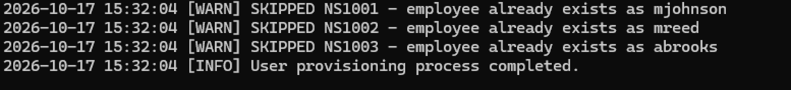
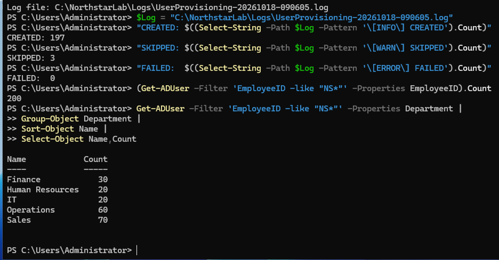
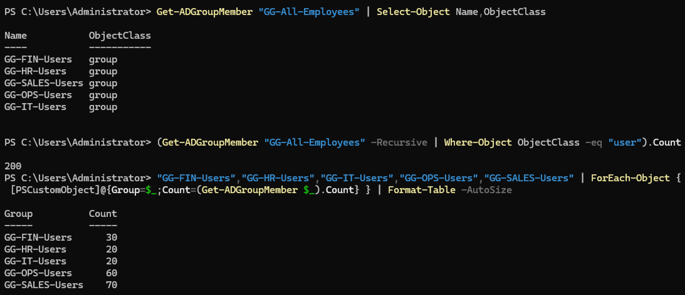

# Northstar Enterprise Endpoint Lab

> Deployed 200-user simulated Windows Server 2025 enterprise environment focused on Active Directory, endpoint administration, PowerShell automation, RBAC, DNS, DHCP, Group Policy, and Windows 11 management.

## Project Overview

Northstar Business Solutions is a fictional 200-employee organization used to simulate the design, deployment, administration, and troubleshooting of a Windows enterprise environment.

The project is being built as a hands-on endpoint and systems administration case study rather than a basic home lab. The environment emphasizes repeatable automation, role-based access control, Active Directory design, endpoint management, documentation, and troubleshooting.

The environment currently contains a fully provisioned 200-user Active Directory workforce distributed across five business departments. User creation, OU placement, security-group assignment, and duplicate detection are automated with PowerShell.

## Current Architecture

| Component | Configuration |
|---|---|
| Domain | `corp.northstar.test` |
| NetBIOS Domain | `NORTHSTAR` |
| Domain Controller | `DC01` |
| DC01 IPv4 | `10.10.10.10/24` |
| Gateway | `10.10.10.1` |
| Server OS | Windows Server 2025 Standard Evaluation |
| Forest Functional Level | Windows Server 2025 |
| Domain Functional Level | Windows Server 2025 |
| Hypervisor | Oracle VirtualBox |
| Virtual Network | `NorthstarNet` |
| Virtual Network Subnet | `10.10.10.0/24` |
| Client OS | Windows 11 Pro |
| Simulated Company Size | 200 employees |

## Lab Evidence

### Active Directory OU Structure

The Northstar domain uses a structured OU hierarchy that separates users, workstations, servers, privileged accounts, service accounts, groups, and disabled objects.


### RBAC / AGDLP Verification

The environment uses an AGDLP-based access model rather than assigning permissions directly to individual users.

**Department resource access**


**Organization-wide employee group nesting**


**Endpoint administrator delegation**


### User Provisioning Idempotence

The provisioning workflow detects existing employees before creating accounts, allowing the script to be rerun without creating duplicate AD objects.



### 200-User Deployment Validation

PowerShell automation was used to provision the full simulated Northstar workforce from a structured CSV dataset.

Validated deployment results:

- **197 new Active Directory accounts created**
- **3 existing test accounts safely skipped**
- **0 provisioning failures**
- **200 total employee accounts**
- Department headcounts validated against the employee dataset



### 200-User RBAC Validation

All 200 employee accounts were assigned to their appropriate departmental Global security groups.

`GG-All-Employees` contains the five departmental Global groups rather than 200 individual user objects. Recursive group membership successfully resolves to all **200 employees**.

Validated departmental group membership:

| Security Group | Members |
|---|---:|
| `GG-FIN-Users` | 30 |
| `GG-HR-Users` | 20 |
| `GG-IT-Users` | 20 |
| `GG-OPS-Users` | 60 |
| `GG-SALES-Users` | 70 |
| **Total** | **200** |



## Completed

- Deployed Windows Server 2025 as `DC01`
- Configured static IPv4 networking
- Created the `corp.northstar.test` Active Directory forest
- Configured AD-integrated DNS
- Verified DNS, NTDS, and NetLogon services
- Built a structured enterprise OU hierarchy
- Automated OU deployment with PowerShell
- Implemented idempotent infrastructure scripting
- Created 15 Active Directory security groups
- Implemented an AGDLP-based RBAC model
- Created departmental and endpoint administration roles
- Verified security-group nesting and resource-access relationships
- Generated a structured 200-employee dataset with PowerShell
- Validated employee IDs, names, required fields, and departmental headcounts
- Automated Active Directory user provisioning from CSV
- Provisioned 197 new accounts while safely skipping 3 existing accounts
- Validated 200 total employee accounts with zero provisioning failures
- Verified departmental headcounts across all five business units
- Verified RBAC membership across all 200 employee accounts
- Verified recursive `GG-All-Employees` membership resolves to all 200 employees

## In Progress

- Windows Server DHCP deployment
- Windows 11 domain integration
- Group Policy configuration
- Department file shares and NTFS permissions
- Endpoint administrative controls
- PowerShell lifecycle automation
- Incident and troubleshooting simulations

## Organizational Structure

Northstar is modeled with five departments:

| Department | Employees |
|---|---:|
| Sales | 70 |
| Operations | 60 |
| Finance | 30 |
| Human Resources | 20 |
| IT | 20 |
| **Total** | **200** |

The Active Directory environment separates users, endpoints, servers, privileged accounts, service accounts, security groups, and disabled objects into dedicated OUs.

### User OU Structure

```text
Northstar
└── Users
    ├── Finance
    ├── Human Resources
    ├── Sales
    ├── Operations
    └── IT
```

### Workstation OU Structure

```text
Northstar
└── Workstations
    ├── Finance
    ├── Human Resources
    ├── Sales
    ├── Operations
    └── IT
```

Additional OUs are used for:

- Servers
- Groups
- Administrative accounts
- Service accounts
- Disabled objects

## Security & RBAC Design

The environment uses an **AGDLP-style** access-control model:

```text
Accounts → Global Groups → Domain Local Groups → Permissions
```

Example department resource-access flow:

```text
Finance User
    ↓
GG-FIN-Users
    ↓
DL-FIN-Share-RW
    ↓
Finance Resource
```

Endpoint administration follows the same principle:

```text
Endpoint Administrator
    ↓
GG-IT-EndpointAdmins
    ↓
DL-Workstation-LocalAdmins
    ↓
Managed Workstations
```

This avoids assigning resource permissions directly to individual users and supports scalable least-privilege administration.

### Department Global Groups

```text
GG-FIN-Users
GG-HR-Users
GG-SALES-Users
GG-OPS-Users
GG-IT-Users
GG-All-Employees
```

### Administrative Global Groups

```text
GG-IT-Helpdesk
GG-IT-EndpointAdmins
```

### Domain Local Resource Groups

```text
DL-FIN-Share-RW
DL-HR-Share-RW
DL-SALES-Share-RW
DL-OPS-Share-RW
DL-IT-Share-RW
DL-Common-Share-R
DL-Workstation-LocalAdmins
```

`GG-All-Employees` contains the five departmental Global groups, allowing organization-wide permissions to be assigned through nested group membership rather than directly to individual employees.

## 200-User Provisioning Workflow

The employee deployment process uses a structured CSV-based workflow rather than manually creating Active Directory accounts.

```text
Employee Dataset
      ↓
CSV Validation
      ↓
Duplicate EmployeeID Check
      ↓
Unique Username Generation
      ↓
Department OU Placement
      ↓
AD Account Creation
      ↓
Department Security Group Assignment
      ↓
Provisioning Log
```

The final employee dataset contains sequential employee IDs from:

```text
NS1001 → NS1200
```

The first three accounts were created during controlled testing:

```text
NS1001  Maya Johnson     Finance
NS1002  Marcus Reed      Sales
NS1003  Aaliyah Brooks   IT
```

During full deployment, the provisioning script detected those existing accounts and safely skipped them while creating the remaining **197 employees**.

Final result:

```text
Created: 197
Skipped:   3
Failed:    0
Total:   200
```

## PowerShell Automation

Current automation includes:

- Enterprise OU creation
- Existing-object detection
- Accidental-deletion protection
- Security-group creation
- Global and Domain Local group configuration
- Automated AGDLP group nesting
- Fictional enterprise employee dataset generation
- CSV-based Active Directory user provisioning
- Required-field validation
- Duplicate EmployeeID detection
- Duplicate employee-name validation
- Sequential employee ID validation
- Unique `sAMAccountName` generation
- Department-based OU placement
- Automatic departmental security-group membership
- Mandatory password change at first logon
- Provisioning activity logging
- Idempotent execution to prevent duplicate objects

### Current Automation

| Script | Purpose |
|---|---|
| [`New-NorthstarOUStructure.ps1`](powershell/New-NorthstarOUStructure.ps1) | Creates the enterprise OU hierarchy and safely detects existing objects |
| [`New-NorthstarSecurityGroups.ps1`](powershell/New-NorthstarSecurityGroups.ps1) | Creates security groups and configures AGDLP/RBAC nesting |
| [`New-NorthstarEmployeeDataset.ps1`](powershell/New-NorthstarEmployeeDataset.ps1) | Generates and validates the fictional 200-employee workforce dataset |
| [`New-NorthstarUsers.ps1`](powershell/New-NorthstarUsers.ps1) | Provisions Active Directory users from CSV, assigns OUs and security groups, prevents duplicate creation, and logs provisioning results |

## Employee Dataset

The simulated workforce is maintained as structured CSV data:

[`employees.csv`](data/employees.csv)

Each employee record contains:

```text
EmployeeID
FirstName
LastName
Department
Title
Office
```

The dataset is fully fictional and designed specifically for the Northstar lab.

## Repository Structure

```text
northstar-enterprise-endpoint-lab/
├── README.md
├── LICENSE
├── .gitignore
│
├── architecture/
│
├── documentation/
│   ├── active-directory-design.md
│   └── rbac-design.md
│
├── powershell/
│   ├── New-NorthstarOUStructure.ps1
│   ├── New-NorthstarSecurityGroups.ps1
│   ├── New-NorthstarEmployeeDataset.ps1
│   └── New-NorthstarUsers.ps1
│
├── screenshots/
│   ├── active-directory/
│   │   └── ou-structure.png
│   │
│   ├── dns/
│   ├── dhcp/
│   ├── group-policy/
│   │
│   ├── powershell/
│   │   ├── rbac-resource-membership.png
│   │   ├── rbac-all-employees-membership.png
│   │   ├── rbac-endpoint-admin-membership.png
│   │   ├── user-provisioning-idempotence.png
│   │   ├── bulk-user-provisioning-validation.png
│   │   └── rbac-200-user-validation.png
│   │
│   └── endpoints/
│
├── data/
│   ├── employees-test.csv
│   └── employees.csv
│
├── incidents/
│
└── .github/
    └── workflows/
```

## Project Goals

The Northstar Enterprise Endpoint Lab is designed to demonstrate practical skills relevant to:

- Systems Administration
- Endpoint Administration
- Desktop Support
- IT Support Engineering
- Windows Server Administration
- Active Directory Administration
- Identity and Access Management
- PowerShell Automation
- Enterprise Troubleshooting

The goal is to build a documented environment that demonstrates not only configuration knowledge, but also the ability to design, automate, validate, troubleshoot, and maintain enterprise Windows infrastructure.

## Project Status

**Current milestone:** 200-user Active Directory deployment completed and validated.

Upcoming work will expand the environment through DHCP, Windows 11 domain integration, Group Policy, enterprise file permissions, endpoint administrative controls, automation, and troubleshooting scenarios.
